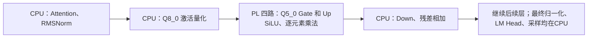

# Gate / Up / SiLU / 逐元素乘法：上板实验结果

日期：2026-10-29（Asia/Shanghai）。**四路融合实现、Vivado 2017.4 时序验收和板端测试已完成。** 本短序列用例中，生成速率从CPU的0.5437 token/s提高到0.6668 token/s，约+22.7%；相对原Q4加速版约+22.0%。局部数值检查通过，但CPU/PL生成文本一致性仍未通过，不能称为模型质量等价加速。

## 当前计算分工

当前模型24层Gate/Up均为Q5_0，K896、输出4864；四路按输出行划分，每路1216行。同一份量化激活进入各路BRAM后供Gate和Up复用，中间结果留在PL，只回传融合结果。

这是独立实验overlay，**保留原四实例B-Lite交付基线**。当前实验中的Down全部走CPU；不是在原Q4硬件旁附加模块，也没有在同一轮推理中动态切换overlay。新旧程序、硬件产物和失败日志分开保存。

## Vivado与硬件验收

| 项目 | 本轮实测 |
| --- | --- |
| 工具、器件 | Vivado2017.4，xc7z020clg400-2 |
| 四路连接 | 四个DMA、四个HP口、64-bit AXIS；64项网表检查和33项HWH检查通过 |
| 仿真 | 1600组有限浮点乘法逐位通过；1870组SiLU×Up通过；68行流式测试通过 |
| 流式覆盖 | K32/64/896/8192、零输入、随机源停顿、输出反压、结果与TLAST稳定性 |
| 流式最大绝对误差 | 2.38419e-6，relative L2=4.24126e-8 |
| 时钟 | 约83.333MHz，12ns约束；板端读回83.333332MHz |
| 最终setup / hold | **WNS+0.442ns / WHS+0.042ns** |
| 完整性 | 所有时序约束满足；无无时钟寄存器或未约束最大延迟引脚 |
| LUT / FF | 23539/53200（44.25%）/18282/106400（17.18%） |
| DSP / BRAM | 24/220（10.91%）/84/140（60.00%） |
| DRC | 无Error/Critical Warning；保留IP/流水建议等Warning/Advisory |
| 导出 | bit/HWH/hwdef/HDF；HDF内bit/HWH与独立文件逐字节相同 |

Gate/Up点积复用Q58实验的整数点积和FP16系数精确累加方法，最后一次舍入为F32；这不保证与ARM中间浮点累加逐位相同。SiLU显式采用Q30 sigmoid表、步长1/256、Q20坐标及线性插值，尾部在±32处饱和，再用有限F32 RNE乘法计算Gate×sigmoid×Up。它是有误差契约的近似实现。

为满足时序，浮点输入、归一化、乘法、尾数对齐和舍入分别寄存，最高位检测采用分层结构；SiLU插值的差值、乘法、求和、符号恢复及转换也分级。前三版未通过时序，均未上板，保留在原构建目录和`failed-v*/`：第一版长路径为归一化/指数，第二版为对齐/舍入，第三版为ROM后插值乘加。最终没有放宽12ns约束或增加时序豁免。

验收产物在`build/gateup2017/quad-2017-v4/`：

- bit SHA256：`d343cbb735b465eaa0503404adb3e8dafcdd8973b0c502f8e0019bdaa8c013a3`。
- HWH SHA256：`d4626478dd0f6c94edea64f8c45ebe6d019f3012071232351dc1c229e0da5fb0`。

## 板端数值与重复事务

- 从当前精确GGUF提取第0层完整Gate/Up矩阵，使用独立C解码和数学参考，8组激活（含零、次正规缩放、不同符号模式）通过；最差relative L2=**2.96912207e-7**，最大绝对差不超过9.53674316e-7。
- 随后100次零激活事务及最终零输出检查通过；共108次四路融合调用。
- 完整24-token固定CPU前缀检查，**553次融合调用全部通过同输入CPU参考的1e-4阈值**，实测最差relative L2=**9.79996804e-7**。参考只用于比较，不替换硬件输出。
- 553=23次decode×24层+1次prefill末层单列计算。prefill最后一层被原图压缩为单输出列，因此也满足融合条件。
- CPU两次完整logits逐位一致；融合版两次自由生成文本逐字节一致。
- 每次融合调用在硬件中计算两个矩阵和SiLU×Up；性能运行实测553次调用、4,820,107,264 MAC，24个权重缓存项。没有用CPU回退冒充硬件执行。

## 生成速度

同一GGUF、固定上游和原集成补丁，prompt为`Write a short story about a robot.`，保持原文本续写模式；ctx256、batch64、ubatch64、双线程、temp0、seed1234、no-warmup，请求24 token，23次decode eval。保留原失败prompt，不通过换输入规避文本差异。

| 路径 | decode时间 | token/s |
| --- | ---: | ---: |
| CPU，无诊断 | 42304.32ms | **0.543680** |
| 原四路Q4加速版 | 42065.02ms | **0.546773** |
| Gate/Up融合版 | 34491.57ms | **0.666830** |
| Gate/Up融合版复测 | 34465.72ms | **0.667330** |

按首轮融合计，生成速率相对CPU提高**22.65%**，相对原Q4版提高**21.96%**。两次融合decode时间相差约0.075%。所有性能运行关闭额外数值复算、剖析和logits文件写入，运行时无并行编译或其他基准任务。加载时间、prefill时间和强制前缀数值检查时间单独保留，不计入上表decode速率。此前带logits捕获的CPU诊断计时不用于速度比例。

融合版首轮累计DMA窗口约6.149s、后端约14.285s，首次权重准备约1.348s。权重包缓存149.625MiB位于普通DDR；每路使用2MiB TX和12KiB RX，不是权重常驻BRAM。打包、搬运、同步和驱动开销仍有优化空间。这是一个短序列用例的速率记录，不推广为所有prompt、上下文或同质量工作负载的加速倍数。

## 文本与logits限制

**文本一致性未通过；模型质量等价尚未评估。** 固定相同CPU token历史时，第2个预测（step1）就出现候选翻转：

| 候选 | Token ID | CPU logit | 融合PL logit |
| --- | ---: | ---: | ---: |
| ` robot` | 12305 | **18.12307549** | 17.93660736 |
| ` story` | 3364 | 17.80375290 | **17.95006561** |

CPU领先分差约0.319323，PL反而让`story`领先约0.013458。该步全词表最大绝对差0.50987530；全部固定前缀24步中的最大绝对差0.74993038。

CPU自由输出以`The robot is named "Bee"...`开头，融合版以`The story should be written in the first person...`开头。固定前缀组输出相同仅是输入控制，不能当成文本一致性通过。局部误差很小依然不能保证网络传播轨迹和候选排序一致；本轮没有对新融合版逐算子定位最早放大边界，也没有以数据集评估困惑度或任务质量。速度提升和这些限制必须一起报告。

## 部署、复现与资源状态

- 入口源码与流程：`compat/gateup2017/README.md`。固定上游revision为`dafae66cc242eb766797194d3c85c5e502625623`，原始`accel/`快照未改动。
- 模型SHA256仍为`23c36f3a641c0062f5f60b1b98c652233a40adcc2c9f6c24df87d2e2b996248c`。
- 新程序SHA256：`3029e019d190d0cf9319f7681a72e095b53140fbdd08ceccfdb80ecd867cbc07`。原B-Lite程序SHA256保持`98dc545163e6fc8de326ca3dfc8127344287274dc61157857b1945f1cd56d91c`。
- 板端独立目录`/home/xilinx/ax7020-gateup2017`，模型链接到既有已验收文件。没有覆盖原程序、旧产物和旧失败日志，没有修改SD启动配置、网络、系统库或系统时间。
- 编译前核对并备份六处上游源码，编译后已恢复且逐项SHA256核对通过。原`llama-build`仍含实验构建配置和对象，后续产出基线程序前须从恢复源码重新构建。
- 测试进程结束，硬件锁已检查可获取；**板卡保留本次Gate/Up融合overlay**。旧Q4运行命令需要先恢复原overlay，不能混用协议。
- 手动体验：在MobaXterm中执行`cd /home/xilinx/ax7020-gateup2017`，再执行`bash run.sh`。该入口先核对并加载匹配产物，再启动聊天；聊天模式没有包含在本次固定prompt质量验收中。

本目录保存`board-result.json`、`accepted.json`、`loaded.json`、最终时序和资源报告、验收凭据、部署哈希、构建/测试小日志及各模式文本。完整原始logits、归档、可执行文件和Vivado工程位于被忽略的`build/gateup2017/`。没有把完整模型权重或凭据写入共享文档。
